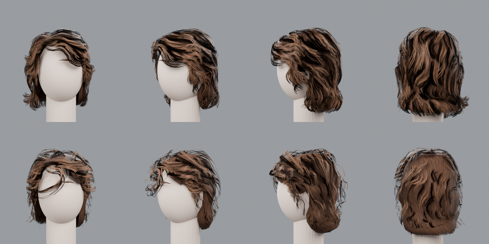

# anakin-clone-wars-hair

`hair_anakin_01_mesh.fbx`(헤어 카드 463장 + 두피 캡 + MetaHuman 계열 아마추어)의 헤어스타일을
레퍼런스 이미지(〈Ahsoka〉 시대 아나킨 스카이워커) 기준으로 바꾸는 Blender(bpy) 파이프라인입니다.

- **[PROMPT.md](PROMPT.md)** — 에셋 분석, 목표 스타일, 제약, 절차, 합격 기준을 담은 작업 프롬프트
- `tools/hair_pipeline.py` — 임포트 → 머티리얼 → 영역별 파라메트릭 카드 변형 → FBX/.blend 내보내기 → 4방향 렌더
- `styles/anakin_ahsoka.json` — 1차 실행 프리셋 (JSON만 바꿔 반복 가능)
- `source/` 원본 FBX · `reference/` 텍스처와 사진 · `output/` 결과 FBX/.blend · `renders/` 비교 렌더

## 실행

```bash
pip install bpy numpy pillow
python3 tools/hair_pipeline.py --style styles/anakin_ahsoka.json --render
```

## 결과 (위: 원본, 아래: `anakin_ahsoka` 프리셋)



원본 토폴로지(9,519 verts / 10,432 tris), UV, 스킨 웨이트, 본 계층은 그대로이며 카드 뿌리는 움직이지 않습니다.
카드 길이는 스케일로만 바꾸므로 스트립 텍스처가 약간 늘어나거나 줄어듭니다. 노멀/플로우 맵은 인코딩이 비표준이라 프리뷰 셰이딩에서 꺼 두었습니다.
